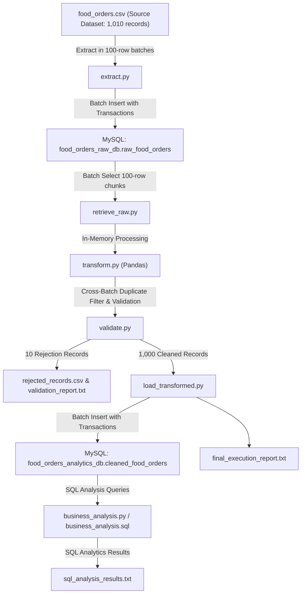

# Food Orders Batch-Based ELT Data Pipeline

[](https://www.python.org/)
[](https://pandas.pydata.org/)
[](https://www.mysql.com/)

A production-grade, batch-based ELT (Extract-Load-Transform) data engineering pipeline built with **Python**, **Pandas**, and **MySQL**.

---

## 📌 Scenario & Objectives

As a Junior Data Engineer for an online food delivery platform, you are tasked with architecting a robust, audit-compliant data pipeline for historical order data (`food_orders.csv`).

The platform requires an ELT architecture that:
1. **Preserves raw historical data** losslessly in a dedicated raw staging database (`food_orders_raw_db.raw_food_orders`), retaining duplicates, raw formats, and missing values.
2. **Retrieves raw records in batches** into Pandas DataFrames for transformation.
3. **Applies data cleansing, deduplication, and feature engineering**, handling cross-batch duplicates, imputing missing categorical values, and calculating key operational metrics:
   - **Delivery Duration**: Difference between order and delivery timestamps in minutes.
   - **Platform Net Revenue**: $\text{Commission Fee} + \text{Delivery Fee} - \text{Payment Processing Fee} - \text{Refunds/Chargebacks}$.
4. **Validates data quality** with automated checks for duplicates, types, nulls, and formula fidelity, generating a formal validation audit report.
5. **Loads processed data** into a production analytical database (`food_orders_analytics_db.cleaned_food_orders`) in batches using database transactions.
6. **Executes business SQL queries** to evaluate revenue, popular channels, payment methods, order values, and delivery performance.

---

## 🏗️ Pipeline Architecture



---

## 📁 Project Structure

```text
food orders/
├── .env                        # Local database credentials and pipeline config
├── .env.example                # Example template for environment variables
├── requirements.txt            # Python dependencies
├── config.py                   # Centralized configuration and DB connection factory
├── extract.py                  # Step 1: Reads CSV in 100-row batches
├── load_raw.py                 # Step 2: Loads original data into raw MySQL database
├── retrieve_raw.py             # Step 3: Retrieves raw records in 100-row batches
├── transform.py                # Step 4: Cleans, deduplicates, and derives metrics
├── validate.py                 # Step 5: Validates data quality and produces reports
├── load_transformed.py         # Step 6: Loads clean data into analytics MySQL database
├── elt_batch_pipeline.py       # Step 7: End-to-end master pipeline orchestrator
├── business_analysis.py        # Step 8: Runs SQL queries to answer business questions
├── business_analysis.sql       # Standalone SQL query file
├── validation_report.txt       # Generated QA validation report
├── rejected_records.csv        # Detailed log of filtered/rejected records
├── final_execution_report.txt  # Pipeline execution summary and metrics
├── sql_analysis_results.txt    # Results of SQL business queries
├── food_orders.csv             # Source dataset (1,010 rows)
└── README.md                   # Complete system documentation
```

---

## 🗄️ Database Schemas

### 1. Raw Database (`food_orders_raw_db`)
- **Table**: `raw_food_orders`
- **Purpose**: Lossless raw staging area. Uses `VARCHAR` types to safely preserve original string formats, missing values (`NULL`), and duplicates without constraint conflicts.

```sql
CREATE TABLE raw_food_orders (
    raw_id INT AUTO_INCREMENT PRIMARY KEY,
    order_id VARCHAR(50) NULL,
    customer_id VARCHAR(50) NULL,
    restaurant_id VARCHAR(50) NULL,
    order_date_and_time VARCHAR(100) NULL,
    delivery_date_and_time VARCHAR(100) NULL,
    order_value VARCHAR(50) NULL,
    delivery_fee VARCHAR(50) NULL,
    payment_method VARCHAR(50) NULL,
    discounts_and_offers VARCHAR(100) NULL,
    commission_fee VARCHAR(50) NULL,
    payment_processing_fee VARCHAR(50) NULL,
    refunds_chargebacks VARCHAR(50) NULL,
    weather_condition VARCHAR(50) NULL,
    order_channel VARCHAR(50) NULL,
    batch_number INT NOT NULL,
    loaded_at TIMESTAMP DEFAULT CURRENT_TIMESTAMP
);
```

### 2. Analytics Database (`food_orders_analytics_db`)
- **Table**: `cleaned_food_orders`
- **Purpose**: Production analytics warehouse table with typed columns, primary key enforcement, and derived analytical attributes.

```sql
CREATE TABLE cleaned_food_orders (
    order_id INT PRIMARY KEY,
    customer_id VARCHAR(50) NOT NULL,
    restaurant_id VARCHAR(50) NOT NULL,
    order_date_time DATETIME NOT NULL,
    delivery_date_time DATETIME NOT NULL,
    order_value DECIMAL(10, 2) NULL,
    delivery_fee DECIMAL(10, 2) NULL,
    payment_method VARCHAR(50) NOT NULL,
    discounts_and_offers VARCHAR(100) NOT NULL,
    commission_fee DECIMAL(10, 2) NULL,
    payment_processing_fee DECIMAL(10, 2) NULL,
    refunds_chargebacks DECIMAL(10, 2) NULL,
    weather_condition VARCHAR(50) NOT NULL,
    order_channel VARCHAR(50) NOT NULL,
    delivery_time_minutes DECIMAL(10, 2) NOT NULL,
    platform_net_revenue DECIMAL(10, 2) NULL,
    order_date DATE NOT NULL,
    order_hour INT NOT NULL,
    batch_number INT NOT NULL,
    loaded_at TIMESTAMP DEFAULT CURRENT_TIMESTAMP
);
```

---

## ⚙️ Transformation & Cleaning Rules

| Requirement | Cleaning & Business Decision | Technical Rationale |
| :--- | :--- | :--- |
| **Cross-Batch Duplicates** | Stateful tracking of `order_id` in a global registry across batches. Duplicate records are rejected and logged to `rejected_records.csv`. | Preserves first occurrence (`keep='first'`). Guarantees uniqueness even when duplicates span different chunks. |
| **Missing Payment Method** | Imputed with `"Unknown"`. | Avoids dropping rows where only the payment method is unrecorded. |
| **Missing Discounts** | Imputed with `"Not Specified"`. | Missing promotional data does not necessarily imply no promo was active. |
| **Financial Null Values** | Retained strictly as `NULL` / `NaN`. **Never** automatically replaced with 0. | Treating an unknown order value or commission fee as 0.00 would severely distort averages and misrepresent revenue. |
| **Timestamps** | Parsed via `pd.to_datetime(..., errors='coerce')`. | Unparseable timestamps are flagged and rejected. |
| **Delivery Duration** | $\text{Delivery Time (Mins)} = \frac{\text{Delivery Date} - \text{Order Date}}{60 \text{ seconds}}$ | Values $< 0$ indicate delivery before ordering and are rejected as invalid. |
| **Platform Net Revenue** | $\text{Commission} + \text{Delivery Fee} - \text{Processing Fee} - \text{Refunds}$ | Computed **only** when all 4 financial components are present; otherwise set to `NULL` to preserve financial audit integrity. |

---

## 🚀 Setup & Execution Guide

### 1. Prerequisites
- Python 3.10+
- MySQL Server or MariaDB (e.g., via XAMPP) running on port `3306`

### 2. Environment Setup
Create a virtual environment and install dependencies:
```bash
python -m venv venv
.\venv\Scripts\activate   # On Windows
pip install -r requirements.txt
```

### 3. Configuration
Copy `.env.example` to `.env` and configure your MySQL credentials:
```ini
DB_HOST=127.0.0.1
DB_PORT=3306
DB_USER=root
DB_PASSWORD=your_mysql_password
RAW_DB_NAME=food_orders_raw_db
ANALYTICS_DB_NAME=food_orders_analytics_db
CSV_PATH=food_orders.csv
BATCH_SIZE=100
```

### 4. Running the Complete Pipeline
Run the master orchestrator to execute the complete ELT workflow end-to-end:
```bash
python elt_batch_pipeline.py
```

### 5. Running Individual Components
Each module can also be tested independently:
```bash
# Extract source CSV in batches
python extract.py

# Ingest raw CSV batches into raw MySQL database
python load_raw.py

# Retrieve batches from raw MySQL table
python retrieve_raw.py

# Run batch transformations & deduplication
python transform.py

# Validate transformed data quality
python validate.py

# Ingest clean records into analytics database
python load_transformed.py

# Run SQL business analysis queries
python business_analysis.py
```

---

## 📊 Business Analysis Queries & Results

The pipeline automatically runs 6 core SQL analytical queries against `food_orders_analytics_db.cleaned_food_orders`:

### 1. What is the total order value?
```sql
SELECT 
    ROUND(SUM(order_value), 2) AS total_order_value,
    COUNT(order_value) AS non_null_count
FROM cleaned_food_orders;
```
- **Result**: **`$1,013,415.00`** (across 960 non-null order values; 40 nulls safely excluded).

### 2. What is the average order value?
```sql
SELECT 
    ROUND(AVG(order_value), 2) AS average_order_value
FROM cleaned_food_orders
WHERE order_value IS NOT NULL;
```
- **Result**: **`$1,055.64`**

### 3. Which payment method has the highest number of orders?
```sql
SELECT 
    payment_method, 
    COUNT(*) AS total_orders
FROM cleaned_food_orders
WHERE payment_method != 'Unknown'
GROUP BY payment_method
ORDER BY total_orders DESC
LIMIT 1;
```
- **Result**: **`Cash on Delivery`** with **336 orders** (33.6%).
  - *Breakdown*: Cash on Delivery: 336 (33.6%), Credit Card: 320 (32.0%), Digital Wallet: 294 (29.4%), Unknown: 50 (5.0%).

### 4. Which order channel has the highest number of orders?
```sql
SELECT 
    order_channel, 
    COUNT(*) AS total_orders
FROM cleaned_food_orders
GROUP BY order_channel
ORDER BY total_orders DESC
LIMIT 1;
```
- **Result**: **`Mobile App`** with **686 orders** (68.6%).
  - *Breakdown*: Mobile App: 686 (68.6%), Partner App: 162 (16.2%), Website: 152 (15.2%).

### 5. What is the average delivery time in minutes?
```sql
SELECT 
    ROUND(AVG(delivery_time_minutes), 2) AS avg_delivery_time
FROM cleaned_food_orders;
```
- **Result**: **`73.58 minutes`** (Range: 30.00 – 119.00 minutes).

### 6. What is the total platform net revenue according to the specified formula?
$$\text{Platform Net Revenue} = \text{Commission Fee} + \text{Delivery Fee} - \text{Payment Processing Fee} - \text{Refunds/Chargebacks}$$
```sql
SELECT 
    ROUND(SUM(platform_net_revenue), 2) AS total_platform_net_revenue,
    COUNT(platform_net_revenue) AS included_orders
FROM cleaned_food_orders
WHERE platform_net_revenue IS NOT NULL;
```
- **Result**: **`$80,877.00`** (calculated across 828 orders with complete financial components; 172 orders with missing components excluded).

---

## 📑 Validation & Quality Assurance Report

The automated validation suite (`validate.py`) executes 7 distinct QA checks:

```text
======================================================================
FOOD ORDERS DATA PIPELINE - DATA QUALITY & VALIDATION REPORT
======================================================================
Total Raw Records Ingested:    1010
Total Transformed Records:     1000
Total Rejected Records:        10
----------------------------------------------------------------------

[CHECK 1] DUPLICATE RECORDS VERIFICATION: [PASS]
  - Duplicate Order IDs:       0
  - Full Duplicate Rows:       0
  - Cross-Batch Duplicates Filtered: 10

[CHECK 2] MANDATORY NON-NULL INTEGRITY: [PASS]
  - All required fields (IDs, Timestamps, Channels) have 0 missing values.

[CHECK 3] COLUMN DATA TYPES VERIFICATION: [PASS]
  - All columns match required analytical database types.

[CHECK 4] DELIVERY DURATION VALIDATION: [PASS]
  - Formula Accuracy:          100% Correct
  - Negative Durations (< 0):  0
  - Min Delivery Duration:     30.00 minutes
  - Max Delivery Duration:     119.00 minutes
  - Mean Delivery Duration:    73.58 minutes
  - Median Delivery Duration:  74.00 minutes

[CHECK 5] PLATFORM NET REVENUE VALIDATION: [PASS]
  - Formula Accuracy:          100% Correct
  - Incomplete Records as NULL: 100% Correct
  - Records with Valid Revenue:828
  - Records with NULL Revenue: 172
  - Total Platform Net Revenue: $80,877.00

[FINANCIAL DATA COMPLETENESS SUMMARY]
  - order_value             :  40 missing (4.0%)
  - delivery_fee            :  50 missing (5.0%)
  - commission_fee          :  40 missing (4.0%)
  - payment_processing_fee  :  50 missing (5.0%)
  - refunds_chargebacks     :  40 missing (4.0%)

[REJECTED RECORDS AUDIT]
  - Duplicate Order ID: 831 already processed: 1 records
  - Duplicate Order ID: 571 already processed: 1 records
  - Duplicate Order ID: 419 already processed: 1 records
  - Duplicate Order ID: 122 already processed: 1 records
  - Duplicate Order ID: 156 already processed: 1 records
  - Duplicate Order ID: 208 already processed: 1 records
  - Duplicate Order ID: 580 already processed: 1 records
  - Duplicate Order ID: 497 already processed: 1 records
  - Duplicate Order ID: 197 already processed: 1 records
  - Duplicate Order ID: 133 already processed: 1 records

======================================================================
FINAL DATA QUALITY VERDICT: ALL CHECKS PASSED [PASSED]
======================================================================
```

---

## 📈 Final Pipeline Execution Summary

```text
======================================================================
                 FINAL PIPELINE EXECUTION REPORT
======================================================================
1. Total Records Extracted from CSV: 1010
2. Total Number of Batches Processed: 11
3. Total Raw Records Loaded to MySQL: 1010
4. Total Raw Records Retrieved from MySQL: 1010
5. Total Valid Records Transformed:   1000
6. Total Rejected Records:           10
7. Total Transformed Records in DB:  1000
8. Successful DB Batches:            21 (11 raw + 10 analytics)
   Failed DB Batches:                0
9. Final Validation Status:          PASSED [SUCCESS]
======================================================================
```

